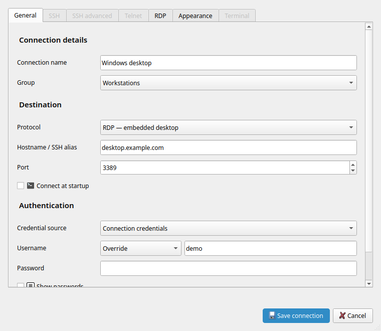

# UniRCm

UniRCm (Uni Remote Connection Manager) is a desktop app for system administrators who use SSH, Telnet, and remote desktops. Open a Linux server shell, connect to a legacy switch, and use a Windows desktop over RDP from the same app.

## What you can do

- Open SSH and Telnet terminals and RDP desktops in tabs. RDP requires the optional FreeRDP 3 bridge.
- Save connections in folders and reuse credentials across profiles. UniRCm stores settings and saved credentials in a SQLCipher database protected by a master password.
- Browse remote directories and transfer files from an SSH session that's already open.

Telnet sends credentials and session data without encryption. Use SSH when the device supports it.

## Screenshots

**Connection manager** with example SSH and RDP profiles organized in groups.


**RDP profile editor** showing the destination and authentication settings for an embedded desktop.



## Transfer files over SSH

Once you're connected, right-click inside the SSH terminal and choose **Upload file** or **Download file**. You can also drop local files onto the terminal to start an upload. UniRCm uses SFTP over the existing authenticated SSH connection, so you can move files without logging in again or opening a separate client. The server must support SFTP.

## Run from source

On Linux, open a terminal in the repository folder. You'll need a graphical desktop, Python 3.11 or later, and the OpenSSH client.

```sh
python3 -m venv .venv
. .venv/bin/activate
python -m pip install -e .
unircm
```

On first launch, create a master password. Then use **File → New connection** to save a profile and double-click it to connect.

To enable RDP, install a C compiler, `pkg-config`, and the FreeRDP 3 and WinPR 3 development libraries. With the virtual environment active, run:

```sh
python -m remote_manager.protocols.build_rdp
```

See the [installation and packaging guide](docs/installation.md) for development setup and Debian package builds.

## Project status

UniRCm is in development on Linux. FreeBSD is a target and still needs testing. VNC is experimental. A future version may support HTTPS for device and server admin pages.

## License

UniRCm is licensed under [GPL-3.0-or-later](LICENSE). See the bundled artwork's [license](src/remote_manager/ui/assets/papirus/LICENSE) and [sources](src/remote_manager/ui/assets/papirus/SOURCES.json).
