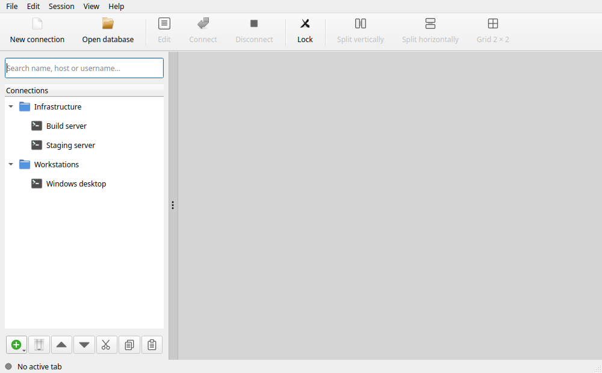
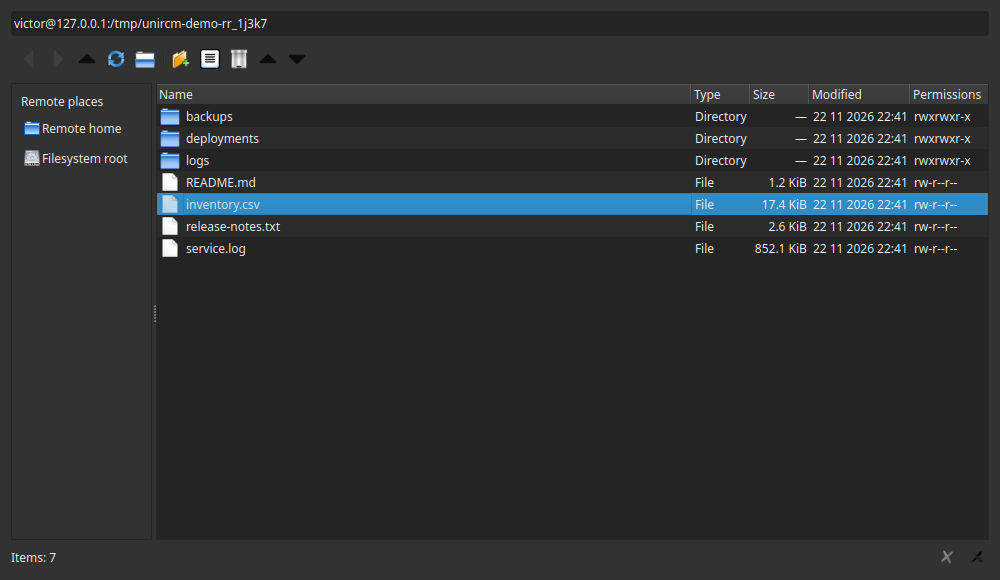

# UniRCm

UniRCm (Uni Remote Connection Manager) is a desktop app for system administrators who use SSH, Telnet and remote desktops. Open a Linux server shell, connect to a legacy switch, and use a Windows desktop over RDP from the same app.

## What you can do

- Open SSH and Telnet terminals and embedded RDP desktops in tabs. The Debian and Ubuntu packages include the FreeRDP 3 bridge. Experimental VNC supports RFB 3.8 with classic password authentication and requires LibVNCClient.
- Save connections in folders and reuse credentials across profiles. UniRCm stores settings and saved credentials in a SQLCipher database protected by a master password.
- Browse remote directories and transfer files from an SSH session that's already open.

Telnet and classic VNC use unencrypted transport. Use SSH where available or tunnel VNC over SSH.

## Screenshots

**Connection manager** with example SSH and RDP profiles organized in groups.



**RDP profile editor** showing the destination and authentication settings for an embedded desktop.


**SSH file manager** showing remote folders, file sizes, modification times, and permissions.



## Transfer files over SSH

Once you're connected, right-click inside the SSH terminal and choose **File manager** to browse remote folders and download selected files. Choose **Upload file** or drop local files onto the terminal to start an upload. UniRCm uses SFTP over the existing authenticated SSH connection, so you can move files without logging in again or opening a separate client. The server must support SFTP.

## Run from source

On Linux, open a terminal in the repository folder. You'll need a graphical desktop, Python 3.11 or later, the OpenSSH client and the Argon2 runtime library (`libargon2-1` on Debian and Ubuntu).

```sh
python3 -m venv .venv
. .venv/bin/activate
python -m pip install -e .
unircm
```

On first launch, create a master password. Then use **File → New connection** to save a profile and double-click it to connect.

When creating a `.uni` archive, you can also generate or select a key file.
To add, replace or remove one later, open **Database settings → Change vault
protection**. Keep a separate copy of each key file you need. If you lose a
required file, you lose access to the archive and any backup that requires it.

UniRCm saves verified encrypted backups beside the database before schema
upgrades and changes to the password or key file. Use **Restore encrypted
backup** on the unlock screen to restore a separate copy. Use the password
and any key file that were valid when the backup was made.

To enable RDP, install a C compiler, `pkg-config`, and the FreeRDP 3 and WinPR 3 development libraries. With the virtual environment active, run:

```sh
python -m remote_manager.protocols.build_rdp
```

See the [installation and packaging guide](docs/installation.md) for development setup and Debian package builds.

## Project status

UniRCm is developed on Linux. See [platform compatibility](docs/compatibility.md) for tested environments and remaining gaps.

## License

UniRCm is licensed under [GPL-3.0-or-later](LICENSE). See the bundled artwork's [license](src/remote_manager/ui/assets/papirus/LICENSE) and [sources](src/remote_manager/ui/assets/papirus/SOURCES.json).
